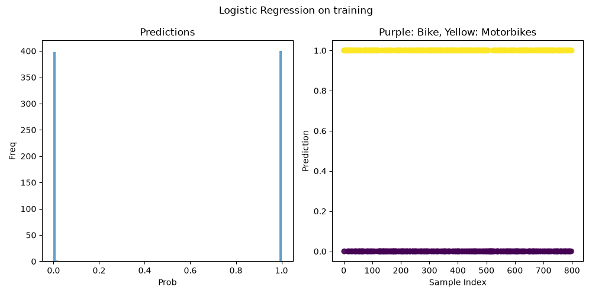
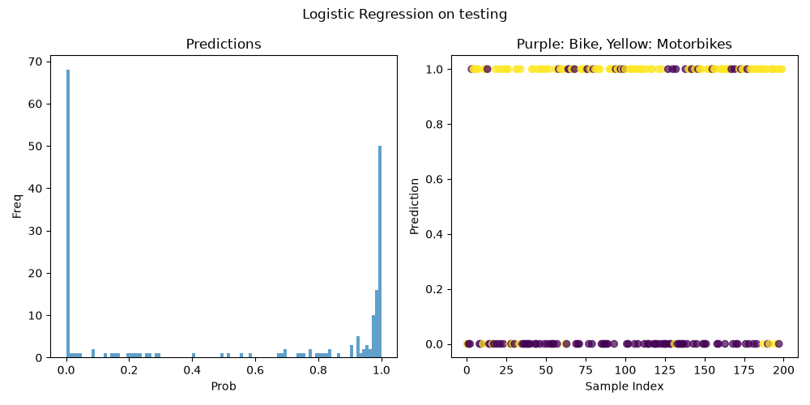
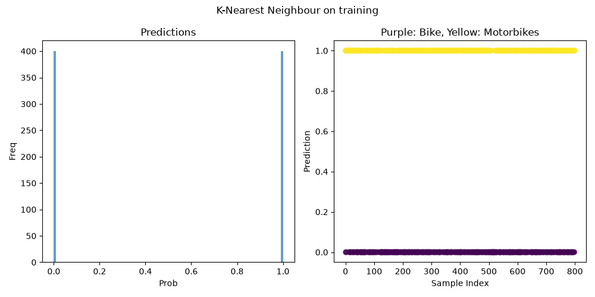
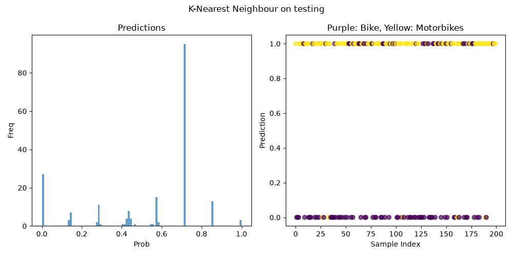
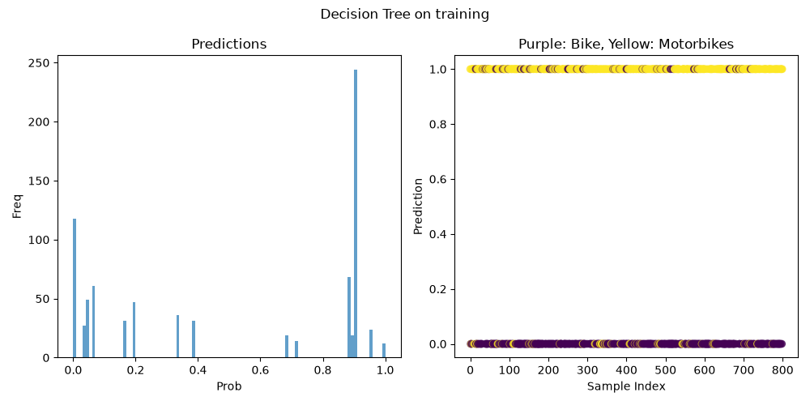
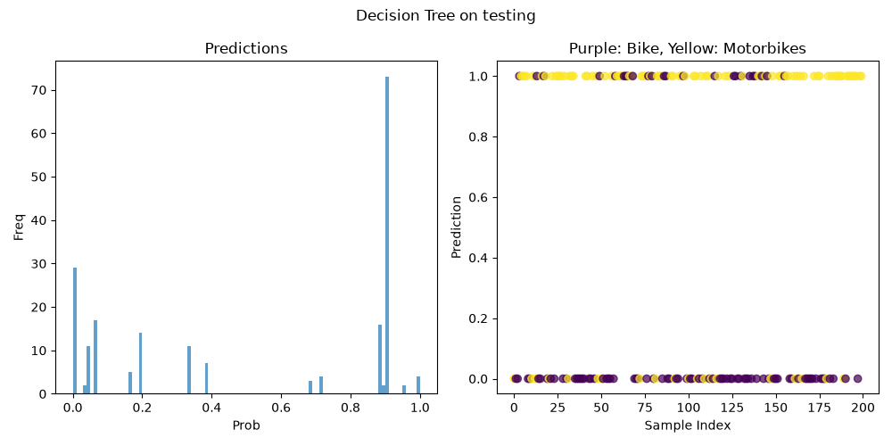
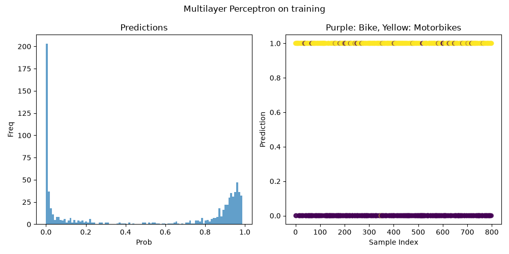
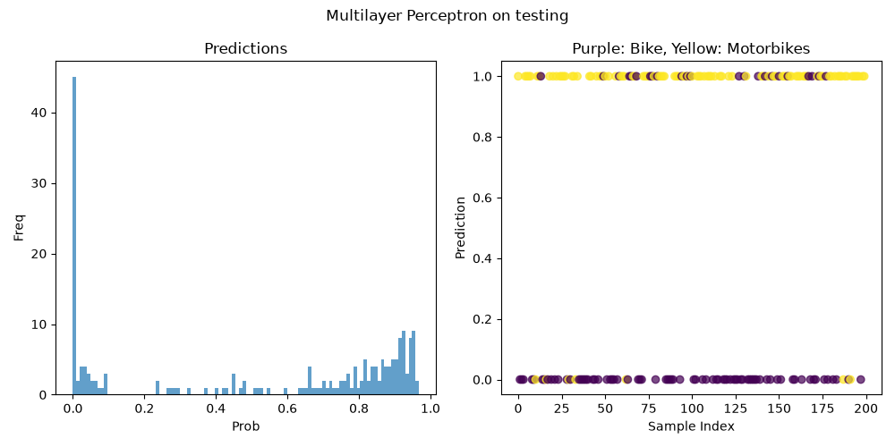

# ct4101-portfolio-project-23359816
Machine Learning python project to classify between bicycles & motorbicycles.
Project built with Python 3.12.3 & Ubuntu 24.04.5 (WSL)

### Table of Contents

- [Repo Structure](#repo-structure)
- [Project Report Documentation](#project-report-documentation)
  - [Data Audit](#data-audit)
  - [Preprocessing Pipeline](#preprocessing-pipeline)
    - [Image Preprocessing Pipeline](#image-preprocessing-pipeline-stages)
    - [Dataset Preprocessing Pipeline](#dataset-preprocessing-pipeline)
- [Models](#models)
- [Setup & Usage](#setup--usage)


## Repo Structure
```
assets/
image-classification-service/
image-processing-service/
output/
.dockerignore
.gitignore
Dockerfile
README.md
requirements.txt
```

#### assets/:
* Contains raw images of bikes & motorbikes in their respective subdirectory (images need to be added by user)

#### [image-classification-service/](image-classification-service/README.md):
* Python application which tests models using generated data by the image-processing-service
* *See application README for application specific structure*

#### [image-processing-service/](image-processing-service/README.md):
* Python application which generates feature data from assets
* *See application README for application specific structure*

#### output/:
* output directory for processed data.

## Project Report Documentation
### Data Audit
As this project generates the engineered features at the runtime of the image processing service, programmatic data auditing is primarily done during the process of generating our features.

This means that there is no explicit data auditing functionality in the image classification service as read data is expected to already be suitably processed in the image processing service.

This model classifies if an image contains a bicycle or a motorbike based on the logic that all images contain one or the other, so if the image is not classified as containing a bicycle, it contains a motorbike.

Describing functionality unused due to massive computational time

The target distribution of this in the dataset is normally 50/50 bike to motorbike, this is the intent for this project but this can be augmented by only supplying the pipeline so many images.

The used dataset should have no outliers given the image processing pipeline explained why [here](#image-preprocessing-pipeline-stages)

#### Notes:
* The features produced by this algorithm is primarily edges.
* Data represents pixel values which are thresholded, as such duplicates are to be expected.

### Preprocessing Pipeline
As mentioned in the last section the images are converted to interpretable data in the image processing service using several steps to extract engineered features.

#### Image Preprocessing Pipeline Stages
1. Reading X number of images in where X is determined by env var `TOTAL_IMAGES_COUNT`.
2. Resizing all the images to be 224 * 224 pixels, creating a standard 2d array size.
3. Smoothing the images using a gaussian smoothing function to reduce noise (outliers).
4. Uses a laplacian to get edge magnitudes.
5. Normalizes the image values.
6. Binary thresholds the images, resulting in pixel values of 0 or 255.
7. Saves the resulting data to output directory

This results in engineered edge features & standardised data size, & as such I decided to not have complex data audit functionality in the image-classifier-service.

#### Notes

* As the image sizes are standardised, the resulting dataset will always be a 3D array with size X * 244 * 244, where X is the number of images processed.
* Image noise are outliers in our dataset. Noise is removed in the gaussian smoothing.

#### Dataset Preprocessing Pipeline
The image-classifier-service still has its own preprocessing pipeline which handles splitting and validation design.

1. Dataset is read from output directory
2. Dataset is normalized to value between 0 & 1
3. Labels are generated using an array of zeroes & ones. This works as we know the dataset is 50/50 between bikes & motorbikes
4. Dataset is split into training & validation sets using a 80/20 split. I decided between 80/20 as the used dataset is small, and will change the split ratio later when using more of the dataset.

## Models 
The following models used a training sample size of 800 & test size of 200
#### **Logistic Regression** (Baseline)
**Metric:** 
| | Value |
| --- | --- |
| **Accuracy** | 0.835 | 
| **Precision** | 0.839103 |
| **Recall** | 0.835 |
| **ROC AUC** | 0.835 |

**Interpretation:** 

(In previous documentation linear regression was considered the baseline, I've decided to use logistic regression instead in order to have a more suitable classification model which can be tested against)

**Example Plots**:




#### **K-Nearest Neighbours**
**Metric:** 
| | Value |
| --- | --- |
| **Accuracy** | 0.835 | 
| **Precision** | 0.839103 |
| **Recall** | 0.835 |
| **ROC AUC** | 0.835 |

**Interpretation:** 

**Example Plots**:




**Evaluation**

#### **Decision Tree Classifier**
**Metric:** 
| | Value |
| --- | --- |
| **Accuracy** | 0.78 | 
| **Precision** | 0.780449 |
| **Recall** | 0.78 |
| **ROC AUC** | 0.78 |

**Interpretation:** 

**Example Plots**:




**Evaluation**

#### **Multi-Layer Perceptron**
**Metric:** 
| | Value |
| --- | --- |
| **Accuracy** | 0.85 | 
| **Precision** | 0.859195 |
| **Recall** | 0.85 |
| **ROC AUC** | 0.85 |

**Interpretation:** 

**Example Plots**:




**Evaluation**

### Comparison


## Setup & Usage
### Quick Start
This outline is made with shell in mind. If you are doing this in a windows environment you may have to change commands with your OS equivelent commands.
I will have a full docker setup done by Milestone 3.

Navigate to root of project and run the following commands

#### Setting up venv
```shell
python -m venv .venv/   # Create virtual environment

source ./venv/bin/activate

pip install -r requirements.txt
```

#### Dataset
The full dataset is found [here](https://www.kaggle.com/datasets/nqa112/vietnamese-bike-and-motorbike/data), requires kaggle login (~12k Records, ~6k each)

A subset dataset can be found [here](https://drive.google.com/drive/folders/1eFPAxoE9lKAigGzh0d0yGFUVXXXuWeLo?usp=sharing)(100 Records 50 each), google drive hosting

Please unzip the dataset to the assets directory, with the following structure:

```
assets/
  bike/
    ...
  motorbike/
    ...
```

Replace environment variable file with your own values & source it.

#### Running applications
```shell
python image-processing-service/src/image-processing/__init__.py -v

python image-classification-service/src/Image-classification/__init__.py -v -p
```

You can read application specific CLI arguments in their respective READMEs. Arguments in the previous are recommended to understand how the process works.

### Useful Commands

#### Activate Environment
```shell
source ./venv/bin/activate
```
---
#### Install Package in Virtual Environment
```shell
pip install <package-name>
```
---
#### Deactivate Environment
```shell
deactivate
```

---
### Notes:
* Docker currently works with the image-processing-service, full compatability will be added shortly with usage instructions

### Assistance Declaration:
* No AI or LLM written code in this codebase. Code snippets were interpreted and refactored from CT4104 lecture materials, CT4109(Image Processing & Computer Vision) lecture materials & scikit API documentation.
